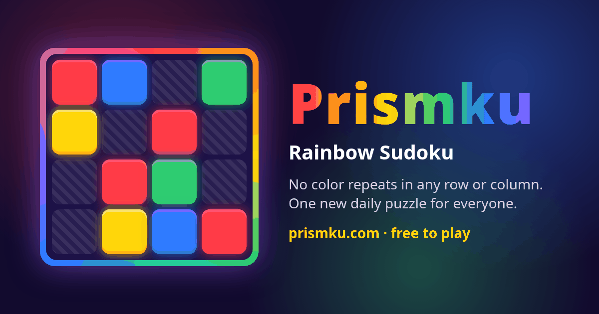

# 🌈 Prismku — Rainbow Sudoku

**Play: https://prismku.com** · Versions: https://prismku.com/versions/

Sudoku with colors instead of numbers. Arrange hues so no color repeats in any row, column or box.
One shared daily puzzle for the whole world, endless free play, leaderboards, achievements and
spoiler-free share grids.



## Features
- 4 difficulties: Easy 4×4 (2×2 boxes), Medium 5×5 (Latin square), Hard 6×6 (2×3 boxes), Expert 9×9 (classic boxes)
- Deterministic, seeded generator — every puzzle has exactly **one** solution (verified by a bitmask solver)
- Daily puzzle (same seed for everyone, rolls over at 00:00 UTC) + free play
- Timer, hints, undo, clash highlighting, keyboard support, sound toggle, colorblind symbols, themes
- Server-verified scores in Cloudflare D1: the Worker regenerates the puzzle from its seed and checks the submitted grid
- Global daily / weekly / all-time leaderboards, achievements, community highlights feed
- Wordle-style share text: ⬜ given · 🟩 first try · 🟨 changed · 🟦 hint
- PWA (installable, offline), OG/Twitter cards, JSON-LD, sitemap
- **Version archive:** every release is frozen under `/v/<YYYY-MM-DD>/` and listed on `/versions/`

## Architecture
```
Browser SPA (vanilla ES modules, no framework)      Cloudflare Worker (src/worker.js)
  client/index.html, app.js, styles.css     ──▶     /api/*  → D1 (rainbow-sudoku-db)
  client/puzzle.js  ◀── shared engine ──▶            everything else → static assets (dist/)
                                                    cron 00:05 UTC → pre-generate dailies, clean rate limits
```
- `client/` — the current game (served at `/`)
- `releases/<date>/` — frozen copies of `client/` (served at `/v/<date>/`, scores disabled there)
- `scripts/build.mjs` — assembles `dist/` (current + archives + `/versions/` + sitemap)
- `scripts/release.mjs` — freezes the current client as a new release
- `migrations/` — D1 schema
- `src/worker.js` — API, validation, rate limiting, achievements

### API
| Method | Path | Notes |
|---|---|---|
| GET | `/api/health` | service + current UTC day |
| GET | `/api/daily?mode=easy` | today's seed/number |
| POST | `/api/player` | `{id, secret, nickname}` – anonymous id, secret proves ownership |
| POST | `/api/scores` | `{playerId, secret, mode, seed, daily, day, grid, timeMs, moves, hints, mistakes}` – verified server-side |
| GET | `/api/leaderboard?mode=&scope=daily\|week\|all` | top 25 |
| GET | `/api/me?id=` | personal bests + achievements |
| GET | `/api/stats` | community stats + highlights |

Anti-abuse: per-IP-hash (salted, rotated daily) rate limits in D1, sane time/move bounds per difficulty,
one daily submission per player, nickname filter.

### D1 tables
`players`, `scores`, `daily_puzzles`, `achievements`, `highlights`, `community_stats`, `rate_limits`.

## Develop
```bash
npm install
npx wrangler d1 migrations apply rainbow-sudoku-db --local
npm run dev            # build + wrangler dev
npm test               # generator uniqueness tests
BASE=http://127.0.0.1:8787 node test/api.test.mjs
BASE=http://127.0.0.1:8787 node test/ui.test.mjs
```

## Release a new daily edition
1. Set `version` in `client/config.js` (and the cache name in `client/sw.js`) to today's date.
2. Make your improvements in `client/`, update `CHANGELOG.md`.
3. `node scripts/release.mjs YYYY-MM-DD "Title" "note 1|note 2"`
4. Commit & push to `main` → auto-deploy.

## Monetization hooks (off by default)
`client/config.js` has `ads`, `tips` and `pro` flags. Nothing is shown until an ad/tip/payment account is configured.
No dark patterns: no forced ads, no paywalled puzzles.

Spec: [docs/SPEC.md](docs/SPEC.md)
