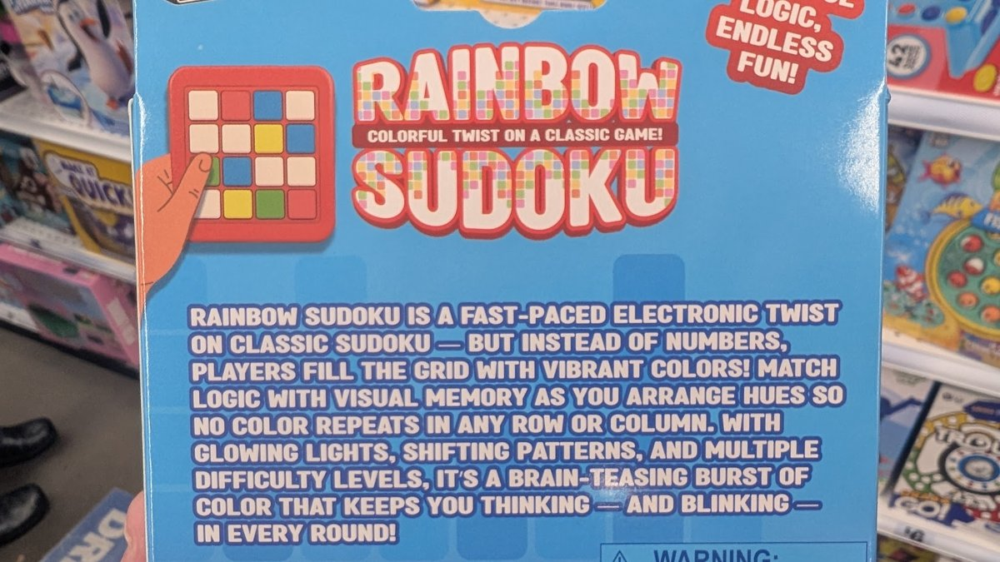

# Prismku — initial game spec (from the product box)

Source: the "Rainbow Sudoku" product box photo supplied by Jake Graff on 2026-10-30 (`docs/spec-box.jpg`).

## Box text (verbatim)

> **RAINBOW SUDOKU** — colorful twist on a classic game!
>
> A fast-paced electronic twist on classic Sudoku, but instead of numbers players fill the grid with vibrant colors.
> Match logic with visual memory as you arrange hues so no color repeats in any row or column.
> Glowing lights, shifting patterns, multiple difficulty levels, a brain-teasing burst of color that keeps you thinking and blinking in every round.
> Simple logic, endless fun!

The box shows a 4×4 grid of glowing colored tiles (red, blue, yellow, green, cream).

## How the spec maps to the game

| Box promise | Implementation |
|---|---|
| Colors instead of numbers | Up to 9 hues; colorblind mode overlays a unique symbol per hue |
| No color repeats in any row or column | Latin-square rules; Easy/Hard/Expert add Sudoku boxes (2×2, 2×3, 3×3) |
| Multiple difficulty levels | Easy 4×4 · Medium 5×5 · Hard 6×6 · Expert 9×9 |
| Glowing lights | Glowing tiles, rotating rainbow "marquee" frame, twinkling tiles |
| Shifting patterns | Animated stripes on empty tiles, drifting background, win wave |
| Fast-paced / every round | Timer, score by speed, shared daily puzzle + endless free play |
| Brain-teasing logic | Every puzzle generated with exactly one solution (verified by solver) |
